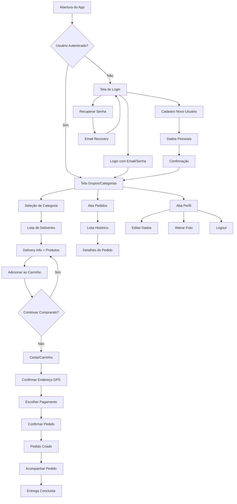

# 02 - Fluxo do Usuário (User Journey)

## 🗺️ Mapa da Jornada do Usuário



## 🚀 Fluxo Principal: Do Login ao Pedido

### 1. **Autenticação** 
- **Entrada:** Tela de Login (`SignIn.js`)
- **Ações:** Email/senha, cadastro, recuperação
- **Saída:** Token Firebase + dados no AsyncStorage

### 2. **Navegação Principal**
- **Drawer Menu** (menu lateral)
- **Bottom Tabs** (abas inferiores)
- **Stack Navigation** (telas empilhadas)

### 3. **Seleção de Categoria**
- **Tela:** Grupos (`pages/Grupos/index.js`)
- **Categorias Disponíveis:**
  - Ofertas (ID: 101)
  - Sanduíches (ID: 102) 
  - Hotdogs (ID: 103)
  - Bebidas (ID: 104)
  - Pratos & Porções (ID: 105)
  - Sushi (ID: 106)
  - Frutas & Verduras (ID: 107)
  - Medicamentos (ID: 108) - *desabilitado*
  - Gás de Cozinha (ID: 109)
  - Floricultura (ID: 110)
  - Água Mineral (ID: 111)
  - Mercado (ID: 112)

### 4. **Lista de Estabelecimentos**
- **Tela:** Deliveries (`pages/Deliveries/index.js`)
- **Filtro:** Por categoria selecionada
- **Exibição:** Cards com info dos estabelecimentos

### 5. **Cardápio do Estabelecimento**
- **Tela:** DeliveryInfo (`pages/Deliveries/DeliveryInfo.js`)
- **Conteúdo:**
  - Informações do estabelecimento
  - Lista de produtos disponíveis
  - Botões de adicionar ao carrinho

### 6. **Adição ao Carrinho**
- **Componente:** Modal de seleção
- **Funcionalidades:**
  - Quantidade
  - Extras/Acréscimos
  - Observações
  - Cálculo automático de valores

### 7. **Carrinho de Compras**
- **Tela:** Cesta (`pages/Cesta/index.js`)
- **Funcionalidades:**
  - Visualizar itens
  - Alterar quantidades
  - Remover produtos
  - Calcular total
  - Confirmar endereço via GPS

### 8. **Confirmação de Endereço**
- **Componente:** GPS Dialog
- **Processo:**
  - Solicitar permissão de localização
  - Obter coordenadas atuais
  - Exibir endereço para confirmação
  - Confirmar ou inserir endereço manual

### 9. **Escolha de Pagamento**
- **Opções Disponíveis:**
  - PIX
  - Cartão de Crédito
  - Ao Portador (Dinheiro)

### 10. **Finalização do Pedido**
- **Dados Enviados:**
  - Produtos do carrinho
  - Endereço de entrega
  - Forma de pagamento
  - Dados do usuário
- **Criação:** OrderContext.createOrder()

## 🔄 Fluxos Secundários

### **Gerenciamento de Perfil**
```
Perfil Tab → Visualizar dados → Editar campos → Salvar → Atualizar contexto
         → Alterar foto → Camera Modal → Capturar → Salvar
         → Logout → Confirmar → Limpar dados → Tela Login
```

### **Histórico de Pedidos**
```
Pedidos Tab → Lista de pedidos → Selecionar pedido → Detalhes completos
                                                   → Mapa da entrega
                                                   → Status em tempo real
```

### **Navegação Lateral (Drawer)**
```
Menu Hamburger → Sidebar → Seletor de idiomas
                       → Opções de navegação
                       → Logout
```

## 📊 Estados da Aplicação

### **Contextos Ativos**
1. **AuthContext** - Usuário logado, token, dados pessoais
2. **CartContext** - Produtos no carrinho, delivery selecionado
3. **OrderContext** - Pedidos ativos, histórico
4. **NotificationContext** - Push token, notificações

### **Estados de Tela**
- **Loading** - Carregamento de dados
- **Error** - Tratamento de erros
- **Empty** - Listas vazias
- **Success** - Operações bem-sucedidas

## 🎯 Pontos Críticos da UX

### **Performance**
- Loading states em todas as operações
- Cache de dados para melhor experiência
- Feedback visual imediato

### **Acessibilidade**
- Textos legíveis e contrastantes
- Botões com tamanho adequado para toque
- Navegação intuitiva

### **Responsividade**
- Layout adaptado para diferentes tamanhos de tela
- Elementos proporcionais
- Margens e espaçamentos consistentes

---

## 🔍 Análise de Fluxos Complexos

### **Sincronização de Dados**
- Firebase RTDB para dados em tempo real
- Backend próprio para operações transacionais
- AsyncStorage para cache local

### **Gerenciamento de Erros**
- Try/catch em todas as operações async
- Alerts informativos para o usuário
- Fallbacks para estados de erro