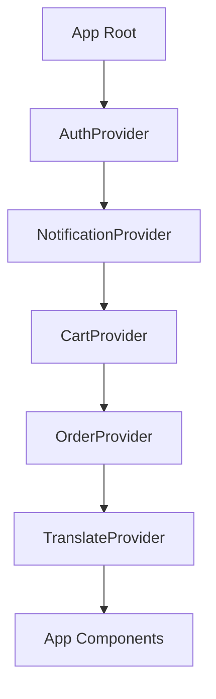

# 05 - Contextos e Gerenciamento de Estado

## 🏗️ Arquitetura de Estados

O UserApp utiliza **Context API** do React para gerenciamento de estado global, organizando dados em 4 contextos principais:



---

## 🔐 AuthContext

### **Localização:** `src/contexts/AuthContext.js`

### **Responsabilidades:**
- Autenticação de usuários
- Gerenciamento de sessão
- Integração Firebase Auth + Backend
- Persistência de dados do usuário

### **Estado:**
```javascript
const [loading, setLoading] = useState(false);
const [authenticated, setAuthenticated] = useState(false);
const [user, setUser] = useState(null);
```

### **Funções Principais:**

#### **signIn(email, password)**
```javascript
// Fluxo completo de login:
// 1. Firebase Auth
const result = await signInWithEmailAndPassword(auth, email, password);
const firebaseUID = result.user.uid;

// 2. Buscar dados no Firebase RTDB
const snapshot = await get(ref(db, `users/${firebaseUID}`));
const rtdbData = snapshot.val();

// 3. Buscar dados completos no backend
const response = await api.get(`/user-app/user/${rtdbData.UserID}`);
const userData = response.data;

// 4. Persistir localmente
await AsyncStorage.setItem('userToken', firebaseUID);
await AsyncStorage.setItem('userData', JSON.stringify(userData));

// 5. Atualizar estado
setUser(userData);
setAuthenticated(true);
```

#### **signUp(userData)**
```javascript
// Fluxo de cadastro:
// 1. Criar conta no Firebase
const result = await createUserWithEmailAndPassword(auth, email, password);

// 2. Salvar no Firebase RTDB
await set(ref(db, `users/${result.user.uid}`), {
  UserID: backendUserId,
  Email: email,
  CreatedAt: new Date().toISOString()
});

// 3. Criar registro no backend
const response = await api.post('/user-app/user', completeUserData);
```

#### **signOut()**
```javascript
// Logout completo:
// 1. Firebase logout
await firebaseSignOut(auth);

// 2. Limpar AsyncStorage
await AsyncStorage.multiRemove(['userToken', 'userData', 'vPushToken']);

// 3. Reset estados
setUser(null);
setAuthenticated(false);
```

#### **checkTokenValidity()**
```javascript
// Verificação de sessão no app startup
const token = await AsyncStorage.getItem('userToken');
if (token) {
  const userData = await AsyncStorage.getItem('userData');
  setUser(JSON.parse(userData));
  setAuthenticated(true);
}
```

### **Provider Value:**
```javascript
<AuthContext.Provider value={{
  user,
  authenticated,
  loading,
  signIn,
  signUp,
  signOut,
  setUser,
  resetPassword
}}>
```

---

## 🛒 CartContext

### **Localização:** `src/contexts/CartContext.js`

### **Responsabilidades:**
- Gerenciar carrinho de compras
- Cálculos de valores
- Persistir delivery selecionado
- Operações CRUD nos produtos

### **Estado:**
```javascript
const [basket, setBasket] = useState([]);
const [delivery, setDelivery] = useState(null);
const [subtotal, setSubTotal] = useState(0);
```

### **Estrutura do Produto no Carrinho:**
```javascript
{
  PRODUTO_ID: string,
  NOME: string,
  DESCRICAO: string,
  VR_UNITARIO: number,
  VR_ACRESCIMOS: number,
  QTD: number,
  TOTAL: number,
  ACRESCIMOS: [
    {
      EXTRA_ID: string,
      NOME: string,
      VALOR: number
    }
  ],
  OBS: string
}
```

### **Funções Principais:**

#### **AddToBasket(produto, qtd, itensAcrescentar, valorAcrescentar, obs)**
```javascript
// Lógica de adição:
const existingIndex = basket.findIndex(
  item => item?.PRODUTO_ID === produto?.PRODUTO_ID
);

if (existingIndex !== -1) {
  // Atualizar quantidade do produto existente
  updatedBasket[existingIndex] = {
    ...updatedBasket[existingIndex],
    QTD: updatedBasket[existingIndex].QTD + qtd,
    TOTAL: updatedBasket[existingIndex].TOTAL + (qtd * totalUnitario)
  };
} else {
  // Adicionar novo produto
  const newItem = {
    ...produto,
    ACRESCIMOS: itensAcrescentar,
    OBS: obs,
    QTD: qtd,
    VR_UNITARIO: produto?.VR_UNITARIO,
    VR_ACRESCIMOS: valorAcrescentar,
    TOTAL: qtd * (produto?.VR_UNITARIO + valorAcrescentar)
  };
  updatedBasket = [...updatedBasket, newItem];
}

setBasketTotal(updatedBasket);
setBasket(updatedBasket);
```

#### **RemoveFromBasket(produto)**
```javascript
// Lógica de remoção:
if (updatedBasket[index]?.QTD > 1) {
  // Diminuir quantidade
  updatedBasket[index] = {
    ...updatedBasket[index],
    QTD: updatedBasket[index].QTD - 1,
    TOTAL: updatedBasket[index].TOTAL - valorUnitario
  };
} else {
  // Remover completamente
  updatedBasket = updatedBasket.filter(
    item => item?.PRODUTO_ID !== produto?.PRODUTO_ID
  );
}
```

#### **setBasketTotal(cart)**
```javascript
// Cálculo do total do carrinho
const result = cart.reduce((acc, obj) => {
  return acc + obj?.TOTAL;
}, 0);
setSubTotal(result);
```

### **Provider Value:**
```javascript
<CartContext.Provider value={{
  basket,
  delivery,
  subtotal,
  AddToBasket,
  RemoveFromBasket,
  CleanBasket,
  setDelivery
}}>
```

---

## 📋 OrderContext

### **Localização:** `src/contexts/OrderContext.js`

### **Responsabilidades:**
- Criar novos pedidos
- Carregar histórico de pedidos
- Gerenciar push tokens
- Sincronizar com backend

### **Estado:**
```javascript
const [pushToken, setPushToken] = useState(null);
const [pedido, setPedido] = useState([]);
const [orders, setOrders] = useState([]);
```

### **Dependências:**
```javascript
const { user } = useContext(AuthContext);
const { delivery } = useContext(CartContext);
```

### **Funções Principais:**

#### **createOrder(orderData)**
```javascript
// Estrutura completa do pedido
const completeOrderData = {
  ...orderData,
  DELIVERY_ID: deliveryId,
  USER_ID: user?.USER_ID,
  PUSH_TOKEN: pushToken,
  CREATED_AT: localTimestamp(),
  UPDATED_AT: localTimestamp()
};

// Envio para backend
const response = await api.post('/user-app/add/pedido', completeOrderData);

if (response.status === 200 || response.status === 201) {
  setPedido(response.data);
  setOrders(prevOrders => [...prevOrders, response.data]);
  return response.data;
}
```

#### **loadOrdersByUserID()**
```javascript
// Carregar pedidos do usuário
if (user?.USER_ID) {
  const response = await api.get(`/user-app/listar/pedidos/usuario/${user.USER_ID}`);
  setOrders(response.data);
}
```

#### **localTimestamp()**
```javascript
// Função utilitária para timestamps
return {
  iso: new Date().toISOString(),
  tzOffsetMinutes: new Date().getTimezoneOffset()
};
```

---

## 📱 NotificationContext

### **Localização:** `src/contexts/NotificationContext.js`

### **Responsabilidades:**
- Gerenciar push tokens
- Configurar notificações
- Estado de notificações recebidas

### **Estado:**
```javascript
const [pushToken, setPushToken] = useState(null);
const [notify, setNotify] = useState(false);
```

### **Configuração de Notificações:**
```javascript
Notifications.setNotificationHandler({
  handleNotification: async () => ({
    shouldShowAlert: true,
    shouldPlaySound: true,
    shouldSetBadge: true,
  }),
});
```

### **Funções Principais:**

#### **getPushToken()**
```javascript
const storedToken = await AsyncStorage.getItem('vPushToken');
setPushToken(storedToken);
return storedToken;
```

---

## 🌐 TranslateContext

### **Localização:** `src/contexts/TranslateContext.js`

### **Responsabilidades:**
- Gerenciar idioma atual
- Alterar idiomas dinamicamente
- Persistir preferência de idioma

### **Estados e Funções:**
```javascript
const [currentLanguage, setCurrentLanguage] = useState('pt-BR');

const changeLanguage = async (langCode) => {
  await i18n.changeLanguage(langCode);
  await AsyncStorage.setItem('selectedLanguage', langCode);
  setCurrentLanguage(langCode);
};

const getLanguageInfo = () => {
  const languages = {
    'pt-BR': { name: 'Português', flag: '🇧🇷' },
    'en-US': { name: 'English', flag: '🇺🇸' },
    'es-LA': { name: 'Español', flag: '🇪🇸' }
  };
  return languages[currentLanguage];
};
```

---

## 🔄 Fluxo de Dados Entre Contextos

### **Sequência de Login:**
1. **AuthContext** → Autentica usuário
2. **NotificationContext** → Obtém push token
3. **AuthContext** → Atualiza dados com push token
4. **CartContext** → Reinicia carrinho
5. **OrderContext** → Carrega pedidos do usuário

### **Sequência de Pedido:**
1. **CartContext** → Monta dados do carrinho
2. **AuthContext** → Fornece dados do usuário
3. **NotificationContext** → Fornece push token
4. **OrderContext** → Cria pedido no backend
5. **CartContext** → Limpa carrinho após sucesso

### **Sincronização de Estados:**
```javascript
// Exemplo de sincronização automática
useEffect(() => {
  if (user?.USER_ID) {
    loadOrdersByUserID(); // Atualiza pedidos quando user muda
  }
}, [user]);

useEffect(() => {
  if (notify) {
    loadPedidos(); // Atualiza lista quando notificação chega
    setNotify(false);
  }
}, [notify]);
```

---

## 💾 Persistência de Dados

### **AsyncStorage Keys:**
- `userToken` - Token do Firebase
- `userData` - Dados completos do usuário
- `vPushToken` - Token de push notifications
- `selectedLanguage` - Idioma selecionado

### **Estratégia de Cache:**
- Dados do usuário: Cache local + sync com Firebase
- Carrinho: Estado temporário (não persistido)
- Pedidos: Cache + atualização em tempo real
- Idioma: Persistido localmente

### **Sincronização:**
- **Real-time:** Firebase RTDB para dados do usuário
- **On-demand:** Backend para pedidos e produtos
- **Local-first:** Preferências e cache