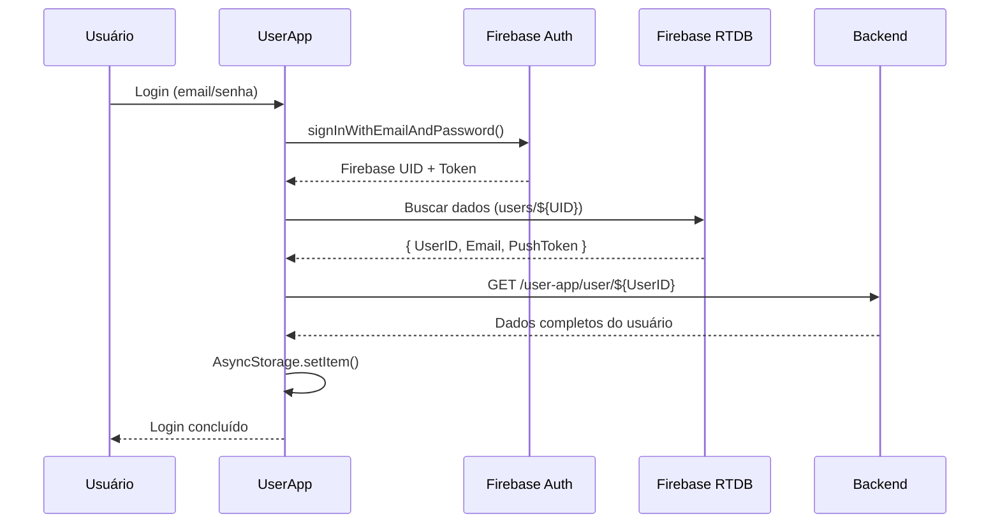
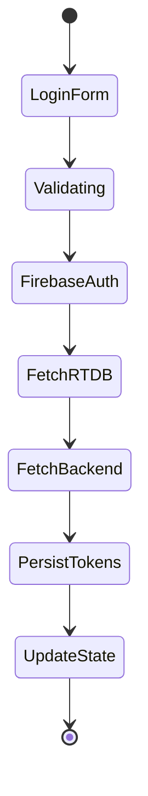
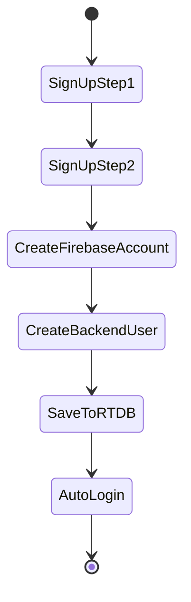
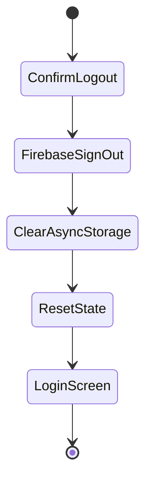

# 06 - Fluxo de Autenticação

## 🔐 Sistema de Autenticação Híbrido

O UserApp utiliza uma arquitetura híbrida combinando **Firebase Auth** para autenticação segura e **backend próprio** para dados de negócio.



---

## 📱 Telas de Autenticação

### **1. SignIn.js** - Tela de Login

#### **Localização:** `src/pages/User/SignIn.js`

#### **Campos do Formulário:**
```javascript
const [email, setEmail] = useState('');
const [password, setPassword] = useState('');
const [loading, setLoading] = useState(false);
```

#### **Validações:**
- Email: formato válido
- Senha: mínimo 6 caracteres
- Campos obrigatórios

#### **Fluxo de Login:**
```javascript
async function signIn() {
  setLoading(true);
  
  try {
    // 1. Validar campos
    if (!email || !password) {
      Alert.alert('Erro', 'Preencha todos os campos');
      return;
    }
    
    // 2. Chamar AuthContext
    await signInFromContext(email, password);
    
    // 3. Navegação automática após sucesso
    // (handled by AuthContext state change)
    
  } catch (error) {
    Alert.alert('Erro', error.message);
  } finally {
    setLoading(false);
  }
}
```

#### **Elementos Visuais:**
- Logo da aplicação
- Campos de email e senha
- Botão de login com loading
- Links para cadastro e recuperação
- Seletor de idiomas

---

### **2. SignUp1.js / SignUp2.js** - Cadastro Multi-etapa

#### **SignUp1.js - Dados Básicos:**
```javascript
// Estados do formulário
const [nome, setNome] = useState('');
const [sobrenome, setSobrenome] = useState('');
const [telefone, setTelefone] = useState('');
const [uf, setUf] = useState('');
const [cidade, setCidade] = useState('');
```

#### **SignUp2.js - Credenciais:**
```javascript
const [email, setEmail] = useState('');
const [password, setPassword] = useState('');
const [confirmPassword, setConfirmPassword] = useState('');
```

#### **Validações por Etapa:**

**Etapa 1:**
- Nome e sobrenome: obrigatórios
- Telefone: formato brasileiro com máscara
- UF: seleção obrigatória
- Cidade: texto livre

**Etapa 2:**
- Email: formato válido + único
- Senha: mínimo 6 caracteres
- Confirmação: deve coincidir

#### **Fluxo de Cadastro:**
```javascript
async function signUp() {
  try {
    // 1. Validar todos os dados
    validateSignUpData();
    
    // 2. Criar conta no Firebase
    const firebaseUser = await createUserWithEmailAndPassword(auth, email, password);
    
    // 3. Gerar UserID no backend
    const backendResponse = await api.post('/user-app/user', {
      NOME: nome,
      SOBRENOME: sobrenome,
      EMAIL: email,
      TELEFONE: telefone,
      UF: uf,
      CIDADE: cidade,
      CREATED_AT: new Date().toISOString()
    });
    
    const userID = backendResponse.data.USER_ID;
    
    // 4. Salvar no Firebase RTDB
    await set(ref(db, `users/${firebaseUser.user.uid}`), {
      UserID: userID,
      Email: email,
      CreatedAt: new Date().toISOString()
    });
    
    // 5. Auto-login
    await signInFromContext(email, password);
    
  } catch (error) {
    handleSignUpError(error);
  }
}
```

---

### **3. Reset.js** - Recuperação de Senha

#### **Localização:** `src/pages/User/Reset.js`

#### **Funcionalidade:**
```javascript
async function resetPassword() {
  try {
    await sendPasswordResetEmail(auth, email);
    Alert.alert(
      'Email enviado',
      'Verifique sua caixa de entrada para redefinir a senha.'
    );
    navigation.goBack();
  } catch (error) {
    Alert.alert('Erro', 'Email não encontrado.');
  }
}
```

---

## 🏗️ AuthContext Detalhado

### **Localização:** `src/contexts/AuthContext.js`

### **Dependências:**
```javascript
import { signInWithEmailAndPassword, createUserWithEmailAndPassword, sendPasswordResetEmail, signOut as firebaseSignOut } from "firebase/auth";
import { getDatabase, ref, set, get } from "firebase/database";
import { auth, firebase_app } from '../config/apiFirebase';
import api from '../config/apiAxios';
```

### **Estados:**
```javascript
const [loading, setLoading] = useState(false);
const [authenticated, setAuthenticated] = useState(false);
const [user, setUser] = useState(null);
```

### **Função signIn Completa:**
```javascript
async function signIn(email, password) {
  setLoading(true);
  console.log('🔐 [AuthContext] Iniciando login com:', { email });

  try {
    // 1. Firebase Auth
    const result = await signInWithEmailAndPassword(auth, email, password);
    const firebaseUID = result.user.uid;
    console.log('✅ [AuthContext] Firebase Auth OK, UID:', firebaseUID);

    // 2. Buscar dados no Firebase RTDB
    const snapshot = await get(ref(db, `users/${firebaseUID}`));
    const rtdbData = snapshot.val() || {};
    const userId = rtdbData.UserID;
    console.log('📊 [AuthContext] Dados RTDB:', rtdbData);

    if (!userId) {
      throw new Error('UserID não encontrado. Verifique o cadastro.');
    }

    // 3. Obter push token
    let pushToken = rtdbData.PushToken;
    if (!pushToken) {
      pushToken = await registerForPushNotificationsAsync();
      if (pushToken) {
        // Atualizar no RTDB
        await set(ref(db, `users/${firebaseUID}/PushToken`), pushToken);
      }
    }

    // 4. Buscar dados completos no backend
    const response = await api.get(`/user-app/user/${userId}`);
    const userData = response.data;
    console.log('👤 [AuthContext] Dados do usuário:', userData);

    // 5. Persistir tokens
    await AsyncStorage.setItem('userToken', firebaseUID);
    await AsyncStorage.setItem('userData', JSON.stringify(userData));
    if (pushToken) {
      await AsyncStorage.setItem('vPushToken', pushToken);
    }

    // 6. Atualizar estado
    setUser(userData);
    setAuthenticated(true);
    
  } catch (error) {
    console.error('❌ [AuthContext] Erro no login:', error);
    Alert.alert('Erro de Login', error.message);
  } finally {
    setLoading(false);
  }
}
```

### **Função checkTokenValidity:**
```javascript
async function checkTokenValidity() {
  try {
    const token = await AsyncStorage.getItem('userToken');
    if (token) {
      const userData = await AsyncStorage.getItem('userData');
      if (userData) {
        const parsedUser = JSON.parse(userData);
        setUser(parsedUser);
        setAuthenticated(true);
        console.log('✅ Sessão restaurada para:', parsedUser.NOME);
      }
    }
  } catch (error) {
    console.error('Erro ao verificar token:', error);
  }
  setLoading(false);
}
```

---

## 🔒 Segurança e Tokens

### **Push Notifications Token:**
```javascript
async function registerForPushNotificationsAsync() {
  let token;

  if (Device.isDevice) {
    const { status: existingStatus } = await Notifications.getPermissionsAsync();
    let finalStatus = existingStatus;

    if (existingStatus !== 'granted') {
      const { status } = await Notifications.requestPermissionsAsync();
      finalStatus = status;
    }

    if (finalStatus !== 'granted') {
      Alert.alert('Erro', 'Permissão de notificação negada!');
      return;
    }

    token = (await Notifications.getExpoPushTokenAsync()).data;
  }

  return token;
}
```

### **Estrutura do Usuário:**
```javascript
// Dados persistidos no AsyncStorage
{
  USER_ID: number,
  NOME: string,
  SOBRENOME: string,
  EMAIL: string,
  TELEFONE: string,
  UF: string,
  CIDADE: string,
  URL_IMAGEM: string,
  CREATED_AT: string,
  UPDATED_AT: string
}
```

### **Estrutura Firebase RTDB:**
```javascript
// users/${firebaseUID}
{
  UserID: number,          // Referência ao backend
  Email: string,           // Para validação
  PushToken: string,       // Expo push token
  CreatedAt: string,       // Timestamp de criação
  LastLogin: string        // Último acesso (opcional)
}
```

---

## 🔄 Fluxos de Autenticação

### **Login Bem-sucedido:**


### **Cadastro de Usuário:**


### **Logout:**


---

## ❌ Tratamento de Erros

### **Erros de Login:**
```javascript
const handleAuthError = (error) => {
  const errorMessages = {
    'auth/user-not-found': 'Usuário não encontrado',
    'auth/wrong-password': 'Senha incorreta',
    'auth/invalid-email': 'Email inválido',
    'auth/user-disabled': 'Usuário desabilitado',
    'auth/too-many-requests': 'Muitas tentativas. Tente novamente mais tarde.'
  };

  const message = errorMessages[error.code] || error.message;
  Alert.alert('Erro de Autenticação', message);
};
```

### **Validação de Dados:**
```javascript
const validateSignUpData = () => {
  if (!nome.trim() || !sobrenome.trim()) {
    throw new Error('Nome e sobrenome são obrigatórios');
  }
  
  if (!email.includes('@')) {
    throw new Error('Email inválido');
  }
  
  if (password.length < 6) {
    throw new Error('Senha deve ter pelo menos 6 caracteres');
  }
  
  if (password !== confirmPassword) {
    throw new Error('Senhas não coincidem');
  }
};
```

---

## 🔧 Configurações

### **Firebase Config:**
```javascript
// src/config/apiFirebase.js
import { initializeApp } from 'firebase/app';
import { getAuth } from 'firebase/auth';
import { getDatabase } from 'firebase/database';

const firebaseConfig = {
  // Configurações do projeto Firebase
};

export const firebase_app = initializeApp(firebaseConfig);
export const auth = getAuth(firebase_app);
export const db = getDatabase(firebase_app);
```

### **Axios Config:**
```javascript
// src/config/apiAxios.js
import axios from 'axios';

const api = axios.create({
  baseURL: 'https://api.deliverybairro.com',
  timeout: 10000,
  headers: {
    'Content-Type': 'application/json'
  }
});
```