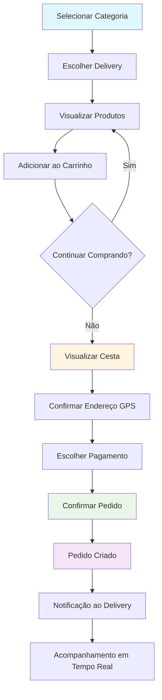
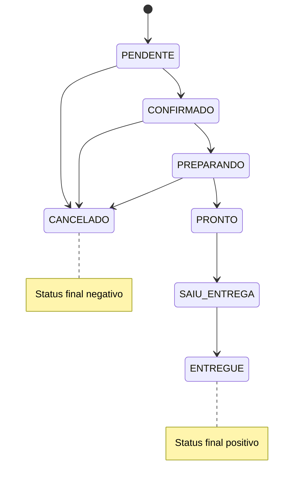

# 07 - Sistema de Pedidos e Pagamentos

## 🛍️ Fluxo Completo de Pedidos



---

## 🛒 Gerenciamento do Carrinho

### **Estrutura do Produto no Carrinho:**
```javascript
{
  PRODUTO_ID: "PRD001",
  NOME: "X-Bacon Especial",
  DESCRICAO: "Hambúrguer com bacon, queijo e salada",
  VR_UNITARIO: 25.90,
  VR_ACRESCIMOS: 5.50,
  QTD: 2,
  TOTAL: 62.80, // (VR_UNITARIO + VR_ACRESCIMOS) * QTD
  ACRESCIMOS: [
    {
      EXTRA_ID: "EXT001",
      NOME: "Bacon Extra",
      VALOR: 3.50
    },
    {
      EXTRA_ID: "EXT002", 
      NOME: "Queijo Cheddar",
      VALOR: 2.00
    }
  ],
  OBS: "Sem cebola, por favor"
}
```

### **Operações do Carrinho:**

#### **1. Adicionar Produto (CartContext.AddToBasket)**
```javascript
async function AddToBasket(produto, qtd, itensAcrescentar, valorAcrescentar, obs) {
  // Verificar se produto já existe no carrinho
  const existingIndex = basket.findIndex(item => 
    item?.PRODUTO_ID === produto?.PRODUTO_ID
  );
  
  let updatedBasket = [...basket];
  
  if (existingIndex !== -1) {
    // Atualizar produto existente
    updatedBasket[existingIndex] = {
      ...updatedBasket[existingIndex],
      QTD: updatedBasket[existingIndex].QTD + qtd,
      TOTAL: updatedBasket[existingIndex].TOTAL + 
             (qtd * (produto?.VR_UNITARIO + valorAcrescentar))
    };
  } else {
    // Adicionar novo produto
    const newItem = {
      ...produto,
      ACRESCIMOS: itensAcrescentar,
      OBS: obs,
      QTD: qtd,
      VR_UNITARIO: produto?.VR_UNITARIO,
      VR_ACRESCIMOS: valorAcrescentar,
      TOTAL: qtd * (produto?.VR_UNITARIO + valorAcrescentar)
    };
    updatedBasket = [...updatedBasket, newItem];
  }
  
  // Atualizar total geral
  setBasketTotal(updatedBasket);
  setBasket(updatedBasket);
}
```

#### **2. Remover/Diminuir Produto (CartContext.RemoveFromBasket)**
```javascript
async function RemoveFromBasket(produto) {
  const index = basket.findIndex(item => 
    item?.PRODUTO_ID === produto?.PRODUTO_ID
  );
  
  let updatedBasket = [...basket];
  
  if (updatedBasket[index]?.QTD > 1) {
    // Diminuir quantidade
    updatedBasket[index] = {
      ...updatedBasket[index],
      QTD: updatedBasket[index].QTD - 1,
      TOTAL: updatedBasket[index].TOTAL - 
             (updatedBasket[index].VR_UNITARIO + updatedBasket[index].VR_ACRESCIMOS)
    };
  } else {
    // Remover completamente
    updatedBasket = updatedBasket.filter(item => 
      item?.PRODUTO_ID !== produto?.PRODUTO_ID
    );
  }
  
  setBasketTotal(updatedBasket);
  setBasket(updatedBasket);
}
```

#### **3. Cálculo de Totais**
```javascript
function setBasketTotal(cart) {
  const subtotal = cart.reduce((acc, item) => acc + item?.TOTAL, 0);
  setSubTotal(subtotal);
  
  // Cálculos adicionais (taxa de entrega, etc.)
  const taxaEntrega = delivery?.TAXA_ENTREGA || 0;
  const total = subtotal + taxaEntrega;
  
  return { subtotal, taxaEntrega, total };
}
```

---

## 📍 Confirmação de Endereço

### **Localização:** `src/pages/Cesta/index.js`

### **Componente GPS:** `src/components/gps/`

#### **Fluxo de Confirmação:**
```javascript
async function confirmarEndereco() {
  try {
    setLoading(true);
    
    // 1. Obter localização atual
    const locationData = await getCurrentLocationStandalone();
    
    const { location, address } = locationData;
    const enderecoFormatado = formatarEndereco(address[0]);
    
    // 2. Preparar dados do pedido
    const orderData = {
      USER_ID: user?.USER_ID,
      DELIVERY_ID: delivery?.DELIVERY_ID,
      ENDERECO_ENTREGA: enderecoFormatado,
      LATITUDE: location.coords.latitude,
      LONGITUDE: location.coords.longitude,
      ITENS: formattedBasketItems(basket),
      SUBTOTAL: subtotal,
      TAXA_ENTREGA: delivery?.TAXA_ENTREGA || 0,
      TOTAL: subtotal + (delivery?.TAXA_ENTREGA || 0),
      STATUS: 'PENDENTE',
      FORMA_PAGAMENTO: null // Será definido na próxima etapa
    };
    
    // 3. Exibir modal de confirmação
    setTempOrderData(orderData);
    setTempAddress(enderecoFormatado);
    setShowModal(true);
    
  } catch (error) {
    Alert.alert('Erro', 'Não foi possível obter sua localização.');
  } finally {
    setLoading(false);
  }
}
```

#### **getCurrentLocationStandalone:**
```javascript
export const getCurrentLocationStandalone = async () => {
  // 1. Solicitar permissão
  const permission = await Location.requestForegroundPermissionsAsync();
  
  if (permission.status !== 'granted') {
    throw new Error('Permissão de localização negada');
  }
  
  // 2. Obter localização
  const location = await Location.getCurrentPositionAsync({
    accuracy: Location.Accuracy.High,
    timeout: 10000
  });
  
  // 3. Converter para endereço
  const address = await Location.reverseGeocodeAsync({
    latitude: location.coords.latitude,
    longitude: location.coords.longitude
  });
  
  return { location, address };
};
```

#### **Modal de Confirmação:**
```javascript
<AddressConfirmationModal
  visible={showModal}
  address={tempAddress}
  onConfirm={() => {
    setShowModal(false);
    // Prosseguir para pagamento
    navigation.navigate('Payment', { orderData: tempOrderData });
  }}
  onCancel={() => {
    setShowModal(false);
    setTempOrderData(null);
  }}
/>
```

---

## 💳 Sistema de Pagamento

### **Formas de Pagamento Disponíveis:**

#### **1. PIX**
```javascript
{
  tipo: 'PIX',
  nome: 'PIX - Transferência Instantânea',
  icon: 'pix-icon',
  processamento: 'INSTANTANEO',
  taxas: 0
}
```

#### **2. Cartão de Crédito**
```javascript
{
  tipo: 'CARTAO_CREDITO',
  nome: 'Cartão de Crédito',
  icon: 'credit-card',
  processamento: 'ONLINE',
  taxas: 0, // Absorvida pelo estabelecimento
  campos_necessarios: [
    'numero_cartao',
    'nome_titular',
    'validade',
    'cvv'
  ]
}
```

#### **3. Ao Portador (Dinheiro)**
```javascript
{
  tipo: 'DINHEIRO',
  nome: 'Ao Portador (Dinheiro)',
  icon: 'money',
  processamento: 'PRESENCIAL',
  taxas: 0,
  observacoes: 'Pagamento na entrega'
}
```

### **Componente de Pagamento:**
```javascript
// src/components/OrderPayments/index.js
export default function OrderPayments({ orderData, onPaymentSelected }) {
  const [selectedPayment, setSelectedPayment] = useState(null);
  const [cardData, setCardData] = useState({});
  
  const paymentMethods = [
    {
      id: 'PIX',
      title: 'PIX',
      description: 'Transferência instantânea',
      icon: 'qrcode'
    },
    {
      id: 'CARTAO_CREDITO', 
      title: 'Cartão de Crédito',
      description: 'Visa, Mastercard, Elo',
      icon: 'credit-card'
    },
    {
      id: 'DINHEIRO',
      title: 'Ao Portador',
      description: 'Pagamento na entrega',
      icon: 'money'
    }
  ];
  
  const handlePaymentConfirm = () => {
    const paymentData = {
      tipo: selectedPayment,
      dados: selectedPayment === 'CARTAO_CREDITO' ? cardData : null,
      valor: orderData.TOTAL
    };
    
    onPaymentSelected(paymentData);
  };
  
  return (
    <View style={styles.container}>
      {paymentMethods.map(method => (
        <PaymentMethodCard 
          key={method.id}
          method={method}
          selected={selectedPayment === method.id}
          onSelect={() => setSelectedPayment(method.id)}
        />
      ))}
      
      {selectedPayment === 'CARTAO_CREDITO' && (
        <CardDataForm 
          data={cardData}
          onChange={setCardData}
        />
      )}
      
      <Button 
        title="Confirmar Pagamento"
        onPress={handlePaymentConfirm}
        disabled={!selectedPayment}
      />
    </View>
  );
}
```

---

## 📝 Criação do Pedido

### **OrderContext.createOrder:**
```javascript
async function createOrder(orderData) {
  try {
    // 1. Validar dados obrigatórios
    const deliveryId = orderData?.DELIVERY_ID || delivery?.DELIVERY_ID;
    
    if (!deliveryId) {
      throw new Error('DELIVERY_ID ausente');
    }
    
    // 2. Montar dados completos
    const completeOrderData = {
      ...orderData,
      DELIVERY_ID: deliveryId,
      USER_ID: orderData?.USER_ID || user?.USER_ID,
      PUSH_TOKEN: orderData?.PUSH_TOKEN || pushToken,
      CREATED_AT: localTimestamp(),
      UPDATED_AT: localTimestamp(),
      STATUS: 'PENDENTE'
    };
    
    // 3. Enviar para backend
    const response = await api.post('/user-app/add/pedido', completeOrderData);
    
    if (response.status === 200 || response.status === 201) {
      // 4. Atualizar estados
      setPedido(response.data);
      setOrders(prevOrders => [...prevOrders, response.data]);
      
      // 5. Limpar carrinho
      CleanBasket();
      
      // 6. Notificar estabelecimento
      await notificarEstabelecimento(response.data);
      
      return response.data;
    }
    
  } catch (error) {
    console.error('Erro ao criar pedido:', error);
    throw error;
  }
}
```

### **Estrutura Completa do Pedido:**
```javascript
{
  PEDIDO_ID: "PED20251108001",
  USER_ID: 123,
  DELIVERY_ID: 456,
  DELIVERY_NOME: "Burger King - Centro",
  
  // Endereço e localização
  ENDERECO_ENTREGA: "Rua das Flores, 123 - Centro",
  LATITUDE: -23.550520,
  LONGITUDE: -46.633308,
  
  // Itens do pedido
  ITENS: [
    {
      PRODUTO_ID: "PRD001",
      NOME: "X-Bacon",
      QTD: 2,
      VR_UNITARIO: 25.90,
      VR_ACRESCIMOS: 5.50,
      TOTAL: 62.80,
      ACRESCIMOS: [...],
      OBS: "Sem cebola"
    }
  ],
  
  // Valores
  SUBTOTAL: 62.80,
  TAXA_ENTREGA: 5.00,
  TOTAL: 67.80,
  
  // Pagamento
  FORMA_PAGAMENTO: {
    tipo: 'PIX',
    status: 'PENDENTE',
    valor: 67.80
  },
  
  // Status e timestamps
  STATUS: 'PENDENTE',
  CREATED_AT: {
    iso: "2025-11-08T14:30:00.000Z",
    tzOffsetMinutes: -180
  },
  UPDATED_AT: {...},
  
  // Notificações
  PUSH_TOKEN: "ExponentPushToken[...]",
  
  // Rastreamento (preenchido pelo delivery)
  TEMPO_PREPARO: null,
  TEMPO_ENTREGA: null,
  ENTREGADOR: null
}
```

---

## 📊 Estados do Pedido

### **Ciclo de Vida:**


### **Notificações por Estado:**
```javascript
const statusNotifications = {
  CONFIRMADO: {
    titulo: 'Pedido Confirmado!',
    corpo: 'Seu pedido foi confirmado pelo estabelecimento.',
    icon: 'check-circle'
  },
  PREPARANDO: {
    titulo: 'Preparando seu pedido',
    corpo: 'O estabelecimento está preparando seu pedido.',
    icon: 'chef-hat'
  },
  PRONTO: {
    titulo: 'Pedido Pronto!',
    corpo: 'Seu pedido está pronto e será enviado em breve.',
    icon: 'package'
  },
  SAIU_ENTREGA: {
    titulo: 'Saiu para Entrega',
    corpo: 'Seu pedido saiu para entrega e chegará em breve.',
    icon: 'truck'
  },
  ENTREGUE: {
    titulo: 'Pedido Entregue!',
    corpo: 'Seu pedido foi entregue com sucesso.',
    icon: 'check-double'
  },
  CANCELADO: {
    titulo: 'Pedido Cancelado',
    corpo: 'Seu pedido foi cancelado.',
    icon: 'x-circle'
  }
};
```

---

## 🔄 Sincronização e Notificações

### **Push Notifications:**
```javascript
// Configuração no NotificationContext
Notifications.setNotificationHandler({
  handleNotification: async () => ({
    shouldShowAlert: true,
    shouldPlaySound: true,
    shouldSetBadge: true,
  }),
});

// Listener para atualizações de pedido
useEffect(() => {
  const subscription = Notifications.addNotificationReceivedListener(
    (notification) => {
      const data = notification.request.content.data;
      
      if (data.tipo === 'status_pedido') {
        // Atualizar lista de pedidos
        setNotify(true);
        
        // Exibir notificação customizada
        showStatusUpdate(data);
      }
    }
  );

  return () => subscription.remove();
}, []);
```

### **Atualização em Tempo Real:**
```javascript
// No componente de pedidos
useEffect(() => {
  if (notify) {
    loadPedidos(); // Recarregar lista
    setNotify(false);
  }
}, [notify, setNotify]);
```

---

## 💾 Persistência e Cache

### **AsyncStorage:**
- Pedidos são carregados do servidor
- Cache temporário para melhor UX
- Limpar após logout

### **Estratégias de Sincronização:**
- **On-demand:** Carregamento inicial
- **Push-driven:** Atualizações via notificação  
- **Periodic:** Sync periódico em background