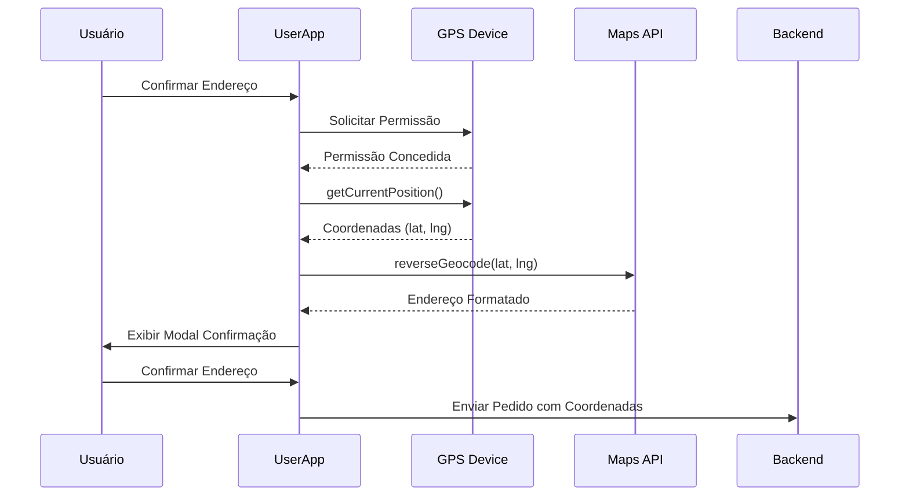

# 08 - Sistema GPS e Mapas

## 📍 Geolocalização e Confirmação de Endereço

O sistema de GPS é fundamental para confirmar o endereço de entrega e garantir a precisão das entregas.



---

## 🗺️ Componentes de Geolocalização

### **1. useGeolocation Hook**

#### **Localização:** `src/components/gps/useGeolocation.js`

```javascript
import * as Location from 'expo-location';

export const getCurrentLocationStandalone = async () => {
  try {
    // 1. Verificar se é dispositivo real
    if (!Device.isDevice) {
      throw new Error('Localização não disponível no simulador');
    }

    // 2. Solicitar permissão
    const permission = await Location.requestForegroundPermissionsAsync();
    
    if (permission.status !== 'granted') {
      throw new Error('Permissão de localização negada');
    }

    // 3. Configurações de precisão
    const locationOptions = {
      accuracy: Location.Accuracy.High,
      timeout: 10000,
      maximumAge: 60000 // Cache por 1 minuto
    };

    // 4. Obter localização atual
    const location = await Location.getCurrentPositionAsync(locationOptions);
    
    // 5. Converter para endereço legível
    const address = await Location.reverseGeocodeAsync({
      latitude: location.coords.latitude,
      longitude: location.coords.longitude
    });

    return {
      location: {
        latitude: location.coords.latitude,
        longitude: location.coords.longitude,
        accuracy: location.coords.accuracy,
        timestamp: location.timestamp
      },
      address: address[0] || {}
    };

  } catch (error) {
    console.error('Erro ao obter localização:', error);
    throw error;
  }
};
```

### **2. Formatação de Endereços**

```javascript
export const formatarEndereco = (addressData) => {
  if (!addressData) return 'Endereço não disponível';
  
  const {
    street,           // Nome da rua
    streetNumber,     // Número
    district,         // Bairro
    city,            // Cidade  
    region,          // Estado
    postalCode,      // CEP
    country          // País
  } = addressData;

  // Formato brasileiro padrão
  let endereco = '';
  
  if (street) {
    endereco += street;
    if (streetNumber) {
      endereco += `, ${streetNumber}`;
    }
  }
  
  if (district) {
    endereco += endereco ? ` - ${district}` : district;
  }
  
  if (city) {
    endereco += endereco ? `, ${city}` : city;
  }
  
  if (region) {
    endereco += ` - ${region}`;
  }
  
  if (postalCode) {
    endereco += ` - CEP: ${postalCode}`;
  }

  return endereco || 'Endereço não identificado';
};
```

### **3. Validação de Localização**

```javascript
export const validarLocalizacao = (location) => {
  const { latitude, longitude, accuracy } = location;
  
  // Verificar se as coordenadas são válidas
  if (!latitude || !longitude) {
    throw new Error('Coordenadas inválidas');
  }
  
  // Verificar se está dentro do Brasil (aproximadamente)
  const brasilBounds = {
    north: 5.27,      // Fronteira norte
    south: -33.75,    // Fronteira sul  
    east: -28.65,     // Fronteira leste
    west: -73.99      // Fronteira oeste
  };
  
  if (latitude > brasilBounds.north || 
      latitude < brasilBounds.south ||
      longitude > brasilBounds.east || 
      longitude < brasilBounds.west) {
    throw new Error('Localização fora da área de entrega');
  }
  
  // Verificar precisão (metros)
  if (accuracy && accuracy > 100) {
    console.warn('Precisão baixa:', accuracy, 'metros');
  }
  
  return true;
};
```

---

## 🎯 Modal de Confirmação de Endereço

### **Localização:** `src/components/gps/AddressConfirmationDialog.js`

```javascript
import React, { useState } from 'react';
import {
  Modal,
  View,
  Text,
  TouchableOpacity,
  TextInput,
  StyleSheet,
  Alert
} from 'react-native';
import { MaterialIcons } from '@expo/vector-icons';
import { useTranslation } from 'react-i18next';

export const AddressConfirmationModal = ({
  visible,
  address,
  coordinates,
  onConfirm,
  onCancel,
  onEditAddress
}) => {
  const { t } = useTranslation();
  const [editMode, setEditMode] = useState(false);
  const [editedAddress, setEditedAddress] = useState(address);

  const handleConfirm = () => {
    if (editMode && editedAddress.trim() === '') {
      Alert.alert('Erro', 'Endereço não pode estar vazio');
      return;
    }

    const finalAddress = editMode ? editedAddress : address;
    
    onConfirm({
      endereco: finalAddress,
      latitude: coordinates?.latitude,
      longitude: coordinates?.longitude,
      editado: editMode
    });
  };

  const handleEdit = () => {
    setEditMode(true);
    setEditedAddress(address);
    onEditAddress?.();
  };

  return (
    <Modal
      visible={visible}
      transparent
      animationType="slide"
      statusBarTranslucent
    >
      <View style={styles.overlay}>
        <View style={styles.container}>
          
          {/* Header */}
          <View style={styles.header}>
            <MaterialIcons name="location-on" size={32} color="#0033CC" />
            <Text style={styles.title}>
              {t('address.confirmTitle', 'Confirme seu endereço')}
            </Text>
          </View>

          {/* Endereço */}
          <View style={styles.addressContainer}>
            {editMode ? (
              <TextInput
                style={styles.addressInput}
                value={editedAddress}
                onChangeText={setEditedAddress}
                placeholder="Digite o endereço de entrega"
                multiline
                numberOfLines={3}
              />
            ) : (
              <Text style={styles.addressText}>{address}</Text>
            )}
          </View>

          {/* Precisão */}
          {coordinates?.accuracy && (
            <View style={styles.accuracyContainer}>
              <MaterialIcons name="gps-fixed" size={16} color="#666" />
              <Text style={styles.accuracyText}>
                Precisão: ±{Math.round(coordinates.accuracy)}m
              </Text>
            </View>
          )}

          {/* Botões */}
          <View style={styles.buttonsContainer}>
            
            {/* Cancelar */}
            <TouchableOpacity
              style={styles.cancelButton}
              onPress={onCancel}
            >
              <Text style={styles.cancelText}>
                {t('common.cancel', 'Cancelar')}
              </Text>
            </TouchableOpacity>

            {/* Editar */}
            {!editMode && (
              <TouchableOpacity
                style={styles.editButton}
                onPress={handleEdit}
              >
                <MaterialIcons name="edit" size={20} color="#666" />
                <Text style={styles.editText}>
                  {t('address.edit', 'Editar')}
                </Text>
              </TouchableOpacity>
            )}

            {/* Confirmar */}
            <TouchableOpacity
              style={styles.confirmButton}
              onPress={handleConfirm}
            >
              <Text style={styles.confirmText}>
                {editMode 
                  ? t('common.save', 'Salvar')
                  : t('address.confirm', 'Confirmar')
                }
              </Text>
            </TouchableOpacity>

          </View>

        </View>
      </View>
    </Modal>
  );
};

const styles = StyleSheet.create({
  overlay: {
    flex: 1,
    backgroundColor: 'rgba(0, 0, 0, 0.5)',
    justifyContent: 'center',
    alignItems: 'center',
    paddingHorizontal: 20
  },
  container: {
    backgroundColor: '#FFF',
    borderRadius: 20,
    padding: 24,
    width: '100%',
    maxWidth: 400,
    shadowColor: '#000',
    shadowOffset: { width: 0, height: 4 },
    shadowOpacity: 0.25,
    shadowRadius: 12,
    elevation: 8
  },
  header: {
    flexDirection: 'row',
    alignItems: 'center',
    marginBottom: 20
  },
  title: {
    fontSize: 18,
    fontWeight: 'bold',
    marginLeft: 12,
    color: '#333',
    flex: 1
  },
  addressContainer: {
    backgroundColor: '#F8F9FA',
    borderRadius: 12,
    padding: 16,
    marginBottom: 12,
    minHeight: 80
  },
  addressText: {
    fontSize: 16,
    lineHeight: 22,
    color: '#333'
  },
  addressInput: {
    fontSize: 16,
    lineHeight: 22,
    color: '#333',
    textAlignVertical: 'top',
    minHeight: 60
  },
  accuracyContainer: {
    flexDirection: 'row',
    alignItems: 'center',
    marginBottom: 20
  },
  accuracyText: {
    fontSize: 12,
    color: '#666',
    marginLeft: 4
  },
  buttonsContainer: {
    flexDirection: 'row',
    justifyContent: 'space-between',
    alignItems: 'center'
  },
  cancelButton: {
    paddingVertical: 12,
    paddingHorizontal: 20,
    borderRadius: 8,
    backgroundColor: '#F1F3F4'
  },
  cancelText: {
    fontSize: 16,
    color: '#666',
    fontWeight: '500'
  },
  editButton: {
    flexDirection: 'row',
    alignItems: 'center',
    paddingVertical: 12,
    paddingHorizontal: 16,
    borderRadius: 8,
    backgroundColor: '#F1F3F4'
  },
  editText: {
    fontSize: 16,
    color: '#666',
    marginLeft: 4,
    fontWeight: '500'
  },
  confirmButton: {
    paddingVertical: 12,
    paddingHorizontal: 24,
    borderRadius: 8,
    backgroundColor: '#0033CC'
  },
  confirmText: {
    fontSize: 16,
    color: '#FFF',
    fontWeight: 'bold'
  }
});
```

---

## 🗺️ Mapas de Entrega

### **Componente de Mapa do Pedido**

#### **Localização:** `src/pages/Pedidos/OrderMapDetails.js`

```javascript
import React, { useState, useEffect } from 'react';
import { View, StyleSheet } from 'react-native';
import MapView, { Marker, Polyline } from 'react-native-maps';

export default function OrderMapDetails({ pedido }) {
  const [mapRegion, setMapRegion] = useState(null);
  const [route, setRoute] = useState(null);

  useEffect(() => {
    if (pedido?.LATITUDE && pedido?.LONGITUDE) {
      // Configurar região do mapa
      const region = {
        latitude: parseFloat(pedido.LATITUDE),
        longitude: parseFloat(pedido.LONGITUDE),
        latitudeDelta: 0.01,
        longitudeDelta: 0.01
      };
      setMapRegion(region);

      // Buscar rota se houver entregador
      if (pedido.ENTREGADOR?.LATITUDE && pedido.ENTREGADOR?.LONGITUDE) {
        calcularRota();
      }
    }
  }, [pedido]);

  const calcularRota = async () => {
    try {
      // Implementar cálculo de rota usando API (Google Maps, Mapbox, etc.)
      // Por enquanto, linha reta
      const routeCoords = [
        {
          latitude: parseFloat(pedido.ENTREGADOR.LATITUDE),
          longitude: parseFloat(pedido.ENTREGADOR.LONGITUDE)
        },
        {
          latitude: parseFloat(pedido.LATITUDE),
          longitude: parseFloat(pedido.LONGITUDE)
        }
      ];
      setRoute(routeCoords);
    } catch (error) {
      console.error('Erro ao calcular rota:', error);
    }
  };

  if (!mapRegion) {
    return <View style={styles.loading} />;
  }

  return (
    <View style={styles.container}>
      <MapView
        style={styles.map}
        region={mapRegion}
        showsUserLocation
        showsMyLocationButton
      >
        
        {/* Marcador do endereço de entrega */}
        <Marker
          coordinate={{
            latitude: parseFloat(pedido.LATITUDE),
            longitude: parseFloat(pedido.LONGITUDE)
          }}
          title="Local de Entrega"
          description={pedido.ENDERECO_ENTREGA}
          pinColor="red"
        />

        {/* Marcador do entregador (se disponível) */}
        {pedido.ENTREGADOR?.LATITUDE && pedido.ENTREGADOR?.LONGITUDE && (
          <Marker
            coordinate={{
              latitude: parseFloat(pedido.ENTREGADOR.LATITUDE),
              longitude: parseFloat(pedido.ENTREGADOR.LONGITUDE)
            }}
            title="Entregador"
            description={pedido.ENTREGADOR.NOME}
            pinColor="blue"
          />
        )}

        {/* Rota (se calculada) */}
        {route && (
          <Polyline
            coordinates={route}
            strokeColor="#0033CC"
            strokeWidth={4}
          />
        )}

      </MapView>
    </View>
  );
}

const styles = StyleSheet.create({
  container: {
    flex: 1
  },
  map: {
    flex: 1
  },
  loading: {
    flex: 1,
    backgroundColor: '#F5F5F5'
  }
});
```

---

## 🔄 Hook de Estado do Mapa

### **Localização:** `src/hooks/useMapState.js`

```javascript
import { useState, useEffect } from 'react';
import * as Location from 'expo-location';

export const useMapState = (initialRegion) => {
  const [region, setRegion] = useState(initialRegion);
  const [userLocation, setUserLocation] = useState(null);
  const [permission, setPermission] = useState(null);

  useEffect(() => {
    requestLocationPermission();
  }, []);

  const requestLocationPermission = async () => {
    try {
      const { status } = await Location.requestForegroundPermissionsAsync();
      setPermission(status);

      if (status === 'granted') {
        getCurrentLocation();
      }
    } catch (error) {
      console.error('Erro ao solicitar permissão:', error);
    }
  };

  const getCurrentLocation = async () => {
    try {
      const location = await Location.getCurrentPositionAsync({
        accuracy: Location.Accuracy.High
      });

      const coords = {
        latitude: location.coords.latitude,
        longitude: location.coords.longitude
      };

      setUserLocation(coords);

      // Atualizar região se não foi definida
      if (!region) {
        setRegion({
          ...coords,
          latitudeDelta: 0.01,
          longitudeDelta: 0.01
        });
      }
    } catch (error) {
      console.error('Erro ao obter localização:', error);
    }
  };

  const updateRegion = (newRegion) => {
    setRegion(newRegion);
  };

  const centerOnUser = () => {
    if (userLocation) {
      setRegion({
        ...userLocation,
        latitudeDelta: 0.01,
        longitudeDelta: 0.01
      });
    }
  };

  return {
    region,
    userLocation,
    permission,
    updateRegion,
    centerOnUser,
    getCurrentLocation
  };
};
```

---

## 📱 Integração com o Cesta

### **Fluxo no Carrinho:**

```javascript
// src/pages/Cesta/index.js
const confirmarEndereco = async () => {
  try {
    setLoading(true);

    // 1. Obter localização
    const locationData = await getCurrentLocationStandalone();
    const { location, address } = locationData;

    // 2. Validar localização
    validarLocalizacao(location);

    // 3. Formatar endereço
    const enderecoFormatado = formatarEndereco(address);

    // 4. Preparar dados do pedido
    const orderData = {
      USER_ID: user?.USER_ID,
      DELIVERY_ID: delivery?.DELIVERY_ID,
      ENDERECO_ENTREGA: enderecoFormatado,
      LATITUDE: location.latitude,
      LONGITUDE: location.longitude,
      ITENS: formattedBasketItems(basket),
      SUBTOTAL: subtotal,
      TAXA_ENTREGA: delivery?.TAXA_ENTREGA || 0,
      TOTAL: subtotal + (delivery?.TAXA_ENTREGA || 0)
    };

    // 5. Exibir modal de confirmação
    setTempOrderData(orderData);
    setTempAddress(enderecoFormatado);
    setShowModal(true);

  } catch (error) {
    handleLocationError(error);
  } finally {
    setLoading(false);
  }
};

const handleLocationError = (error) => {
  const errorMessages = {
    'Permissão de localização negada': 'Precisamos da sua localização para realizar a entrega. Por favor, permita o acesso.',
    'Localização fora da área de entrega': 'Desculpe, não entregamos nesta região.',
    'Coordenadas inválidas': 'Não foi possível determinar sua localização. Tente novamente.',
    'Localização não disponível no simulador': 'Use um dispositivo real para testar a localização.'
  };

  const message = errorMessages[error.message] || 'Erro ao obter localização. Tente novamente.';
  
  Alert.alert('Erro de Localização', message, [
    { text: 'Tentar Novamente', onPress: confirmarEndereco },
    { text: 'Inserir Manualmente', onPress: () => setShowManualAddress(true) },
    { text: 'Cancelar', style: 'cancel' }
  ]);
};
```

---

## ⚙️ Configurações e Otimizações

### **Permissões (app.json):**
```json
{
  "expo": {
    "permissions": [
      "LOCATION",
      "ACCESS_FINE_LOCATION",
      "ACCESS_COARSE_LOCATION"
    ],
    "ios": {
      "infoPlist": {
        "NSLocationWhenInUseUsageDescription": "Este app precisa de acesso à localização para confirmar o endereço de entrega."
      }
    },
    "android": {
      "permissions": [
        "ACCESS_FINE_LOCATION",
        "ACCESS_COARSE_LOCATION"
      ]
    }
  }
}
```

### **Otimizações de Performance:**
```javascript
// Cache de localização
const LOCATION_CACHE_TIME = 60000; // 1 minuto
let lastLocation = null;
let lastLocationTime = 0;

const getCachedLocation = async () => {
  const now = Date.now();
  
  if (lastLocation && (now - lastLocationTime) < LOCATION_CACHE_TIME) {
    return lastLocation;
  }
  
  const location = await getCurrentLocationStandalone();
  lastLocation = location;
  lastLocationTime = now;
  
  return location;
};

// Debounce para múltiplas chamadas
import { useMemo } from 'react';
import { debounce } from 'lodash';

const debouncedGetLocation = useMemo(
  () => debounce(getCurrentLocationStandalone, 1000),
  []
);
```