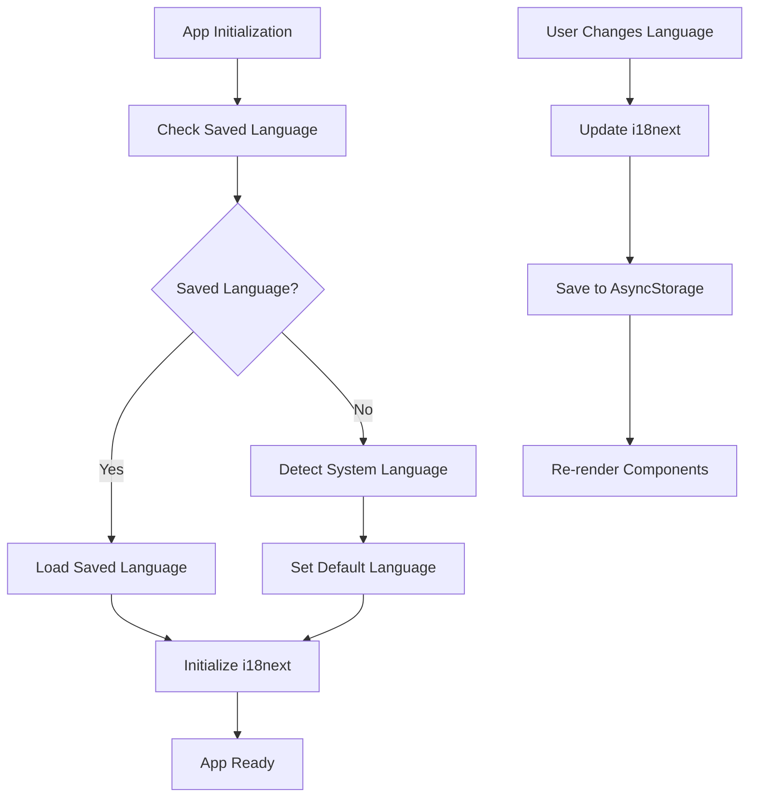

# 09 - Sistema de Internacionalização (i18n)

## 🌐 Suporte Multi-idioma

O UserApp suporta três idiomas: **Português Brasileiro**, **Inglês Americano** e **Espanhol Latino-americano**.



---

## 🔧 Configuração do i18next

### **Arquivo Principal:** `src/i18n.js`

```javascript
import i18n from 'i18next';
import { initReactI18next } from 'react-i18next';
import * as Localization from 'expo-localization';
import AsyncStorage from '@react-native-async-storage/async-storage';

// Importar arquivos de tradução
import ptBR from './locales/pt-BR.json';
import enUS from './locales/en-US.json';
import esLA from './locales/es-LA.json';

// Recursos de idioma
const resources = {
  'pt-BR': { translation: ptBR },
  'en-US': { translation: enUS },
  'es-LA': { translation: esLA }
};

// Detectar idioma do sistema
const getSystemLanguage = () => {
  const systemLocale = Localization.locale;
  
  // Mapear locales do sistema para nossos códigos
  const languageMap = {
    'pt-BR': 'pt-BR',
    'pt': 'pt-BR',
    'en-US': 'en-US', 
    'en': 'en-US',
    'es': 'es-LA',
    'es-419': 'es-LA',
    'es-MX': 'es-LA',
    'es-AR': 'es-LA'
  };
  
  return languageMap[systemLocale] || 'pt-BR';
};

// Função para obter idioma salvo
const getSavedLanguage = async () => {
  try {
    const savedLang = await AsyncStorage.getItem('selectedLanguage');
    return savedLang || getSystemLanguage();
  } catch (error) {
    console.error('Erro ao carregar idioma salvo:', error);
    return getSystemLanguage();
  }
};

// Inicialização
const initI18n = async () => {
  const language = await getSavedLanguage();
  
  i18n
    .use(initReactI18next)
    .init({
      resources,
      lng: language,
      fallbackLng: 'pt-BR',
      
      interpolation: {
        escapeValue: false // React já faz o escape
      },
      
      react: {
        useSuspense: false // Evita problemas de loading
      },
      
      // Configurações de debug
      debug: __DEV__,
      
      // Namespace padrão
      defaultNS: 'translation',
      
      // Configurações de detecção
      detection: {
        order: ['asyncStorage', 'navigator'],
        caches: ['asyncStorage']
      }
    });
    
  return i18n;
};

// Exportar instância configurada
export default initI18n;
```

---

## 📝 Estrutura dos Arquivos de Tradução

### **pt-BR.json** - Português Brasileiro
```json
{
  "welcome": {
    "title": "Bem-vindo!",
    "subtitle": "deliverybairro.com - UserApp"
  },
  "navigation": {
    "home": "Início", 
    "groups": "Grupos",
    "deliveries": "Deliveries",
    "orders": "Meus Pedidos",
    "profile": "Perfil",
    "cart": "Carrinho",
    "logout": "Sair (Fechar)",
    "closeMenu": "Fechar Este Menu"
  },
  "tabs": {
    "deliveries": "Deliveries",
    "orders": "Meus Pedidos", 
    "profile": "Perfil"
  },
  "headers": {
    "delivery": "Deliveries (Grupos)",
    "deliveriesList": "Lista de Deliveries",
    "deliveryInfo": "Delivery Info",
    "orders": "Meus Pedidos",
    "orderDetails": "Detalhes do Pedido",
    "profile": "Dados do Usuário"
  },
  "auth": {
    "login": "Entrar",
    "register": "Cadastrar",
    "email": "Email",
    "password": "Senha",
    "confirmPassword": "Confirmar Senha",
    "forgotPassword": "Esqueceu a senha?",
    "resetPassword": "Redefinir Senha",
    "name": "Nome",
    "lastName": "Sobrenome", 
    "phone": "Telefone",
    "state": "Estado",
    "city": "Cidade"
  },
  "categories": {
    "ofertas": "Ofertas",
    "sanduiches": "Sanduiches", 
    "hotdogs": "Hotdogs",
    "bebidas": "Bebidas",
    "pratosporcoes": "Pratos & Porções",
    "sushi": "Sushi",
    "frutasverduras": "Frutas & Verduras",
    "medicamentos": "Medicamentos",
    "gasdecozinha": "Gás de Cozinha",
    "floricultura": "Floricultura",
    "aguamineral": "Água Mineral",
    "mercado": "Mercado"
  },
  "cart": {
    "title": "Carrinho de Compras",
    "empty": "Seu carrinho está vazio",
    "subtotal": "Subtotal",
    "deliveryFee": "Taxa de Entrega",
    "total": "Total",
    "confirmAddress": "Confirmar Endereço",
    "finalize": "Finalizar Pedido",
    "quantity": "Quantidade",
    "observations": "Observações"
  },
  "address": {
    "confirmTitle": "Confirme seu endereço",
    "confirm": "Confirmar",
    "edit": "Editar",
    "current": "Endereço atual",
    "gpsError": "Erro ao obter localização",
    "permissionDenied": "Permissão de localização negada"
  },
  "payment": {
    "title": "Forma de Pagamento",
    "pix": "PIX",
    "creditCard": "Cartão de Crédito", 
    "cash": "Dinheiro",
    "cardNumber": "Número do Cartão",
    "cardHolder": "Nome do Portador",
    "expiryDate": "Validade",
    "cvv": "CVV"
  },
  "orders": {
    "title": "Meus Pedidos",
    "empty": "Nenhum pedido encontrado",
    "status": {
      "pending": "Pendente",
      "confirmed": "Confirmado", 
      "preparing": "Preparando",
      "ready": "Pronto",
      "outForDelivery": "Saiu para Entrega",
      "delivered": "Entregue",
      "cancelled": "Cancelado"
    },
    "details": "Detalhes",
    "track": "Rastrear"
  },
  "profile": {
    "title": "Perfil",
    "editPhoto": "Alterar Foto",
    "save": "Salvar",
    "logout": "Sair"
  },
  "common": {
    "loading": "Carregando...",
    "error": "Erro",
    "success": "Sucesso",
    "cancel": "Cancelar",
    "ok": "OK", 
    "save": "Salvar",
    "edit": "Editar",
    "delete": "Excluir",
    "add": "Adicionar",
    "remove": "Remover",
    "search": "Buscar",
    "filter": "Filtrar",
    "retry": "Tentar Novamente"
  },
  "language": {
    "current": "Idioma atual",
    "select": "Selecionar idioma",
    "portuguese": "Português",
    "english": "English", 
    "spanish": "Español"
  }
}
```

### **en-US.json** - Inglês Americano
```json
{
  "welcome": {
    "title": "Welcome!",
    "subtitle": "deliverybairro.com - UserApp"
  },
  "navigation": {
    "home": "Home",
    "groups": "Grupos", 
    "deliveries": "Deliveries",
    "orders": "My Orders",
    "profile": "Profile",
    "cart": "Cart",
    "logout": "Logout",
    "closeMenu": "Close Menu"
  },
  "tabs": {
    "deliveries": "Deliveries",
    "orders": "My Orders",
    "profile": "Profile"
  },
  "auth": {
    "login": "Login",
    "register": "Register",
    "email": "Email", 
    "password": "Password",
    "confirmPassword": "Confirm Password",
    "forgotPassword": "Forgot Password?",
    "name": "First Name",
    "lastName": "Last Name"
  },
  "categories": {
    "ofertas": "Offers",
    "sanduiches": "Sandwiches",
    "hotdogs": "Hot Dogs",
    "bebidas": "Beverages",
    "pratosporcoes": "Dishes & Portions"
  },
  "cart": {
    "title": "Shopping Cart",
    "empty": "Your cart is empty", 
    "subtotal": "Subtotal",
    "total": "Total",
    "confirmAddress": "Confirm Address"
  },
  "payment": {
    "pix": "PIX Transfer",
    "creditCard": "Credit Card",
    "cash": "Cash"
  }
}
```

### **es-LA.json** - Espanhol Latino-americano
```json
{
  "welcome": {
    "title": "¡Bienvenido!",
    "subtitle": "deliverybairro.com - UserApp"
  },
  "navigation": {
    "home": "Inicio",
    "categories": "Categorías",
    "deliveries": "Deliveries", 
    "orders": "Mis Pedidos",
    "profile": "Perfil",
    "cart": "Carrito"
  },
  "auth": {
    "login": "Iniciar Sesión", 
    "register": "Registrarse",
    "email": "Correo",
    "password": "Contraseña"
  },
  "categories": {
    "ofertas": "Ofertas",
    "sanduiches": "Sándwiches", 
    "bebidas": "Bebidas"
  }
}
```

---

## 🎛️ LanguageSelector Component

### **Localização:** `src/components/LanguageSelector/index.js`

```javascript
import React, { useState } from 'react';
import {
  View,
  Text,
  TouchableOpacity,
  Modal,
  FlatList,
  StyleSheet
} from 'react-native';
import { useTranslation } from 'react-i18next';
import { useTranslateContext } from '../../contexts/TranslateContext';
import { MaterialIcons } from '@expo/vector-icons';

const LanguageSelector = ({ containerStyle = {}, textStyle = {} }) => {
  const { t } = useTranslation();
  const { currentLanguage, changeLanguage, getLanguageInfo } = useTranslateContext();
  const [modalVisible, setModalVisible] = useState(false);

  // Definir idiomas disponíveis
  const languages = [
    { 
      code: 'pt-BR', 
      name: 'Português', 
      nativeName: 'Português (Brasil)',
      flag: '🇧🇷' 
    },
    { 
      code: 'en-US', 
      name: 'English', 
      nativeName: 'English (US)',
      flag: '🇺🇸' 
    },
    { 
      code: 'es-LA', 
      name: 'Español', 
      nativeName: 'Español (Latinoamérica)',
      flag: '🇪🇸' 
    }
  ];

  const currentLangInfo = languages.find(lang => lang.code === currentLanguage);

  const handleLanguageSelect = async (langCode) => {
    try {
      await changeLanguage(langCode);
      setModalVisible(false);
    } catch (error) {
      console.error('Erro ao alterar idioma:', error);
    }
  };

  const renderLanguageItem = ({ item }) => (
    <TouchableOpacity
      style={[
        styles.languageOption,
        currentLanguage === item.code && styles.selectedLanguageOption
      ]}
      onPress={() => handleLanguageSelect(item.code)}
    >
      <View style={styles.languageContent}>
        <Text style={styles.flag}>{item.flag}</Text>
        <View style={styles.languageTextContainer}>
          <Text style={[
            styles.languageName,
            currentLanguage === item.code && styles.selectedLanguageName
          ]}>
            {item.name}
          </Text>
          <Text style={[
            styles.languageNative,
            currentLanguage === item.code && styles.selectedLanguageNative
          ]}>
            {item.nativeName}
          </Text>
        </View>
        {currentLanguage === item.code && (
          <MaterialIcons 
            name="check" 
            size={20} 
            color="#0033CC" 
          />
        )}
      </View>
    </TouchableOpacity>
  );

  return (
    <>
      {/* Botão para abrir selector */}
      <TouchableOpacity
        style={[styles.selector, containerStyle]}
        onPress={() => setModalVisible(true)}
      >
        <View style={styles.selectorContent}>
          <Text style={styles.selectorFlag}>{currentLangInfo?.flag}</Text>
          <Text style={[styles.selectorText, textStyle]}>
            {currentLangInfo?.name || 'Português'}
          </Text>
          <MaterialIcons name="expand-more" size={20} color="#666" />
        </View>
      </TouchableOpacity>

      {/* Modal de seleção */}
      <Modal
        animationType="slide"
        transparent={true}
        visible={modalVisible}
        onRequestClose={() => setModalVisible(false)}
      >
        <View style={styles.modalOverlay}>
          <View style={styles.modalContent}>
            
            <View style={styles.modalHeader}>
              <Text style={styles.modalTitle}>
                {t('language.select', 'Selecionar idioma')}
              </Text>
              <TouchableOpacity
                onPress={() => setModalVisible(false)}
                style={styles.closeButton}
              >
                <MaterialIcons name="close" size={24} color="#666" />
              </TouchableOpacity>
            </View>

            <FlatList
              data={languages}
              renderItem={renderLanguageItem}
              keyExtractor={(item) => item.code}
              showsVerticalScrollIndicator={false}
            />
          
          </View>
        </View>
      </Modal>
    </>
  );
};

const styles = StyleSheet.create({
  selector: {
    backgroundColor: '#F8F9FA',
    borderRadius: 8,
    paddingHorizontal: 12,
    paddingVertical: 10,
    borderWidth: 1,
    borderColor: '#E1E5E9'
  },
  selectorContent: {
    flexDirection: 'row',
    alignItems: 'center',
    justifyContent: 'space-between'
  },
  selectorFlag: {
    fontSize: 20,
    marginRight: 8
  },
  selectorText: {
    fontSize: 16,
    color: '#333',
    flex: 1
  },
  modalOverlay: {
    flex: 1,
    backgroundColor: 'rgba(0, 0, 0, 0.5)',
    justifyContent: 'center',
    alignItems: 'center'
  },
  modalContent: {
    backgroundColor: '#FFF',
    margin: 20,
    borderRadius: 16,
    paddingVertical: 20,
    minWidth: 280,
    maxHeight: '60%'
  },
  modalHeader: {
    flexDirection: 'row',
    justifyContent: 'space-between',
    alignItems: 'center',
    paddingHorizontal: 20,
    paddingBottom: 16,
    borderBottomWidth: 1,
    borderBottomColor: '#E1E5E9'
  },
  modalTitle: {
    fontSize: 18,
    fontWeight: 'bold',
    color: '#333'
  },
  closeButton: {
    padding: 4
  },
  languageOption: {
    paddingHorizontal: 20,
    paddingVertical: 16
  },
  selectedLanguageOption: {
    backgroundColor: '#F0F7FF'
  },
  languageContent: {
    flexDirection: 'row',
    alignItems: 'center'
  },
  flag: {
    fontSize: 24,
    marginRight: 12
  },
  languageTextContainer: {
    flex: 1
  },
  languageName: {
    fontSize: 16,
    fontWeight: '500',
    color: '#333'
  },
  selectedLanguageName: {
    color: '#0033CC'
  },
  languageNative: {
    fontSize: 14,
    color: '#666',
    marginTop: 2
  },
  selectedLanguageNative: {
    color: '#0033CC'
  }
});

export default LanguageSelector;
```

---

## 🔄 TranslateContext

### **Localização:** `src/contexts/TranslateContext.js`

```javascript
import React, { createContext, useState, useEffect, useContext } from 'react';
import AsyncStorage from '@react-native-async-storage/async-storage';
import { useTranslation } from 'react-i18next';

const TranslateContext = createContext();

export const useTranslateContext = () => {
  const context = useContext(TranslateContext);
  if (!context) {
    throw new Error('useTranslateContext must be used within TranslateProvider');
  }
  return context;
};

export const TranslateProvider = ({ children }) => {
  const { i18n } = useTranslation();
  const [currentLanguage, setCurrentLanguage] = useState('pt-BR');

  useEffect(() => {
    loadSavedLanguage();
  }, []);

  const loadSavedLanguage = async () => {
    try {
      const savedLang = await AsyncStorage.getItem('selectedLanguage');
      if (savedLang) {
        setCurrentLanguage(savedLang);
        await i18n.changeLanguage(savedLang);
      }
    } catch (error) {
      console.error('Erro ao carregar idioma salvo:', error);
    }
  };

  const changeLanguage = async (langCode) => {
    try {
      // Alterar no i18n
      await i18n.changeLanguage(langCode);
      
      // Salvar preferência
      await AsyncStorage.setItem('selectedLanguage', langCode);
      
      // Atualizar estado
      setCurrentLanguage(langCode);
      
      console.log(`Idioma alterado para: ${langCode}`);
    } catch (error) {
      console.error('Erro ao alterar idioma:', error);
      throw error;
    }
  };

  const getLanguageInfo = () => {
    const languages = {
      'pt-BR': { name: 'Português', flag: '🇧🇷' },
      'en-US': { name: 'English', flag: '🇺🇸' },
      'es-LA': { name: 'Español', flag: '🇪🇸' }
    };
    return languages[currentLanguage] || languages['pt-BR'];
  };

  const getLanguageOptions = () => [
    { code: 'pt-BR', name: 'Português', flag: '🇧🇷' },
    { code: 'en-US', name: 'English', flag: '🇺🇸' },
    { code: 'es-LA', name: 'Español', flag: '🇪🇸' }
  ];

  return (
    <TranslateContext.Provider value={{
      currentLanguage,
      changeLanguage,
      getLanguageInfo,
      getLanguageOptions
    }}>
      {children}
    </TranslateContext.Provider>
  );
};
```

---

## 🎯 Uso nos Componentes

### **Hook useTranslation:**
```javascript
import { useTranslation } from 'react-i18next';

export default function MeuComponente() {
  const { t } = useTranslation();

  return (
    <View>
      <Text>{t('welcome.title')}</Text>
      <Text>{t('navigation.home')}</Text>
      
      {/* Com valor padrão */}
      <Text>{t('novo.texto', 'Texto padrão se não existir')}</Text>
      
      {/* Com interpolação */}
      <Text>{t('user.welcome', { name: 'João' })}</Text>
    </View>
  );
}
```

### **Navegação com i18n:**
```javascript
// src/routes/App.Routes.js
function getHeaderTitle(route) {
  const routeName = getFocusedRouteNameFromRoute(route) ?? 'HomeTab';
  
  switch (routeName) {
    case 'HomeTab': return t('headers.groups');
    case 'Deliveries': return t('headers.deliveriesList');
    case 'OrdersTab': return t('headers.orders');
    case 'ProfileTab': return t('headers.profile');
    default: return t('headers.groups');
  }
}
```

---

## 🚀 Inicialização no App

### **App.js:**
```javascript
import React, { useState, useEffect } from 'react';
import { NavigationContainer } from '@react-navigation/native';
import initI18n from './src/i18n';
import { TranslateProvider } from './src/contexts/TranslateContext';

export default function App() {
  const [i18nReady, setI18nReady] = useState(false);

  useEffect(() => {
    initI18n().then(() => {
      setI18nReady(true);
    });
  }, []);

  if (!i18nReady) {
    return <LoadingScreen />;
  }

  return (
    <TranslateProvider>
      <NavigationContainer>
        {/* Resto da aplicação */}
      </NavigationContainer>
    </TranslateProvider>
  );
}
```

---

## 📱 Recursos Específicos de Idioma

### **Formatação de Valores:**
```javascript
// Formato de moeda por idioma
const formatCurrency = (value, language) => {
  const formatters = {
    'pt-BR': new Intl.NumberFormat('pt-BR', {
      style: 'currency',
      currency: 'BRL'
    }),
    'en-US': new Intl.NumberFormat('en-US', {
      style: 'currency', 
      currency: 'USD'
    }),
    'es-LA': new Intl.NumberFormat('es-MX', {
      style: 'currency',
      currency: 'MXN'
    })
  };
  
  return formatters[language]?.format(value) || `R$ ${value}`;
};

// Formato de data
const formatDate = (date, language) => {
  const options = {
    year: 'numeric',
    month: 'short', 
    day: 'numeric',
    hour: '2-digit',
    minute: '2-digit'
  };
  
  const locales = {
    'pt-BR': 'pt-BR',
    'en-US': 'en-US',
    'es-LA': 'es-MX'
  };
  
  return new Date(date).toLocaleDateString(locales[language], options);
};
```

### **Máscaras de Input:**
```javascript
// Máscara de telefone por região
const getPhoneMask = (language) => {
  const masks = {
    'pt-BR': '(99) 99999-9999',
    'en-US': '+1 (999) 999-9999',
    'es-LA': '+52 (999) 999-9999'
  };
  
  return masks[language] || masks['pt-BR'];
};
```